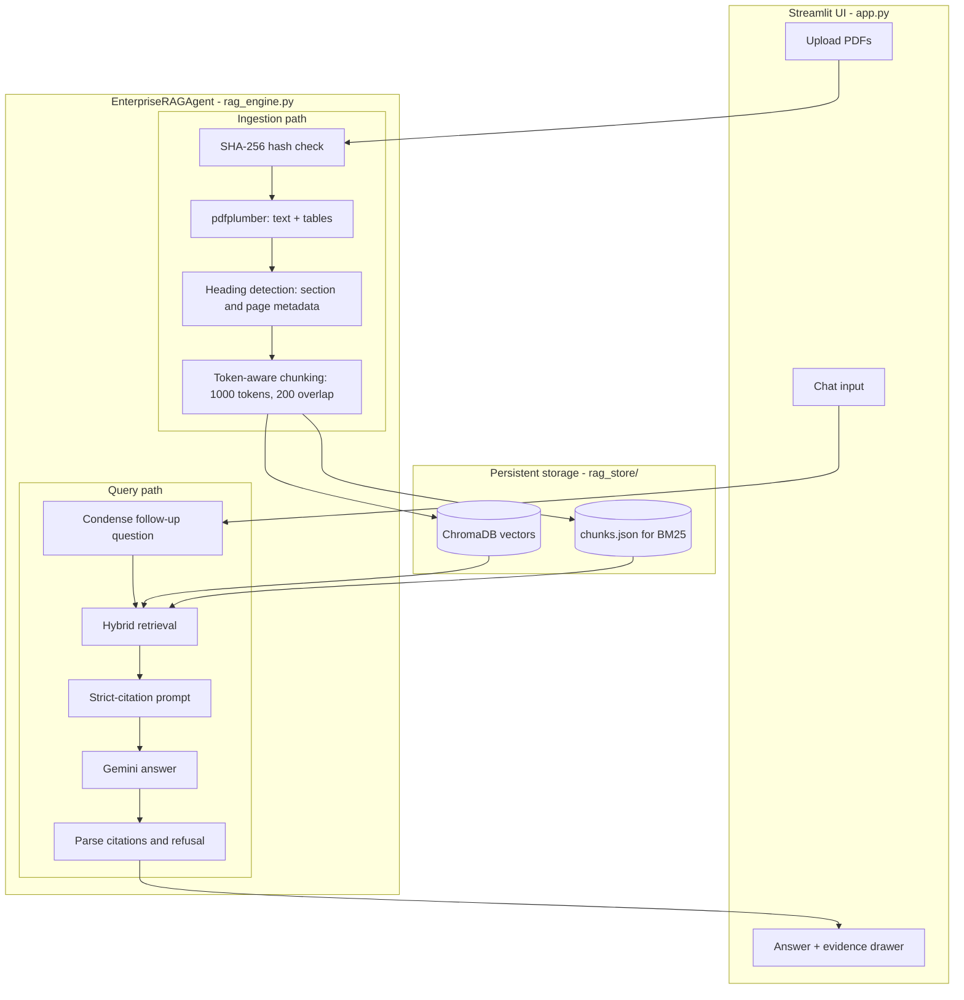
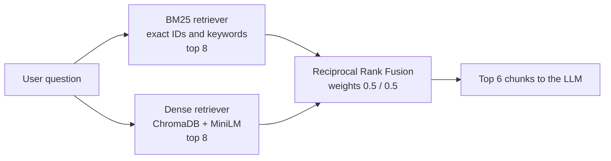
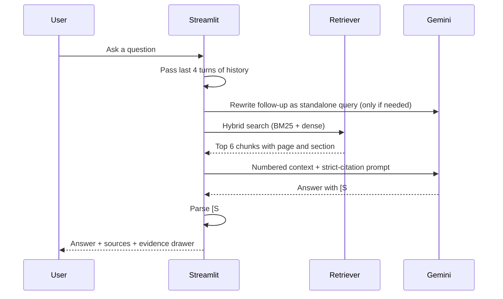

# Enterprise Policy Compliance RAG Agent

A Retrieval-Augmented Generation (RAG) application that answers questions over enterprise policy PDFs with **exact citations** (document, page, section) and **refuses to answer** when the information is not in the documents.

It combines **hybrid retrieval** (BM25 keyword search + dense vector search, fused with Reciprocal Rank Fusion), **table-aware PDF parsing**, and a **strict-grounding prompt** for Google Gemini, behind a Streamlit chat dashboard.


---

## Table of contents
1. [Why this project](#why-this-project)
2. [Key features](#key-features)
3. [Tech stack](#tech-stack)
4. [Architecture](#architecture)
5. [How it works, step by step](#how-it-works-step-by-step)
6. [Project structure](#project-structure)
7. [Setup and run](#setup-and-run)
8. [Configuration](#configuration)
9. [Design decisions](#design-decisions)
10. [Known limitations](#known-limitations)
11. [Roadmap](#roadmap)
12. [Troubleshooting](#troubleshooting)
13. [Security notes](#security-notes)

---

## Why this project

Policy documents are full of exact identifiers (`SEC-POL-4.2.1`), thresholds, and tables. Pure semantic search often misses exact IDs, while keyword search misses paraphrases. And in a compliance setting, a confident wrong answer is worse than no answer.

This agent is built around three rules:
- **Find the right clause** using both keyword and semantic retrieval.
- **Answer only from retrieved text**, with a citation on every claim.
- **Say "not found"** instead of guessing.

---

## Key features

- **Multi-PDF ingestion** with text, bullet lists, and tables
- **Table-aware parsing:** tables are extracted separately and stored as markdown so rows and columns stay intact
- **Section metadata:** headings are detected so every chunk carries a `section` label
- **Hybrid retrieval:** BM25 + ChromaDB vector search, fused with weighted Reciprocal Rank Fusion (50/50)
- **Policy-ID-aware keyword search:** a custom BM25 tokenizer keeps IDs like `hr-4.2.1` as one token and also indexes their parts
- **Strict citation pipeline:** every fact is followed by `[S#]` markers; a Sources list gives document, page, and section
- **Refusal behavior:** one fixed sentence when the context does not contain the answer
- **Follow-up handling:** questions like "who approves it?" are rewritten into standalone queries using chat history
- **Evidence drawer:** expandable view of every retrieved snippet, with CITED / CONTEXT and TEXT / TABLE badges
- **Persistent index:** vectors and chunks are saved to disk, so documents survive restarts
- **Deduplication:** SHA-256 file hashing skips identical re-uploads and replaces changed versions
- **Per-stage timing:** retrieval and generation latency are shown under each answer

---

## Tech stack

| Layer | Technology |
|---|---|
| Language | Python 3.10+ |
| Orchestration | LangChain 0.3 |
| LLM | Google Gemini via `langchain-google-genai` |
| Dense retrieval | ChromaDB (local persistent) + `sentence-transformers/all-MiniLM-L6-v2` |
| Sparse retrieval | Rank-BM25 via LangChain `BM25Retriever` |
| Fusion | LangChain `EnsembleRetriever` (weighted Reciprocal Rank Fusion) |
| PDF parsing | pdfplumber |
| Chunking | `RecursiveCharacterTextSplitter` with tiktoken (`cl100k_base`) |
| UI | Streamlit |
| Config | python-dotenv |

---

## Architecture

### System overview



### Hybrid retrieval



### Request lifecycle for one question



---

## How it works, step by step

### 1. Ingestion (`ingest_pdf`)

1. **Hash and deduplicate.** The file's SHA-256 hash is compared with the stored one. Identical content is skipped. A changed file with the same name replaces the old version.
2. **Parse with pdfplumber** (`parse_pdf`).
   - Tables are detected with `find_tables()` and converted to markdown (first row as header).
   - Table areas are excluded from the body text, so table cells are not duplicated as garbled paragraphs.
   - Unmapped bullet glyphs (`(cid:N)`) are restored as bullets where the cleanup applies.
3. **Detect headings** with regex patterns (numbered headings like `4.2 Incident Reporting`, `Section/Article/Policy ...`, all-caps titles). Page text is split at each heading so every segment gets an accurate `section` label.
4. **Chunk** with `RecursiveCharacterTextSplitter` using tiktoken: 1000 tokens, 200 overlap, with separators that prefer paragraph and table-row boundaries before sentences.
5. **Index twice:**
   - Embeddings (`all-MiniLM-L6-v2`, normalized) go into **ChromaDB**.
   - Raw chunks go into **`chunks.json`**, which is used to rebuild the BM25 index.

### 2. Retrieval (`retrieve`)

1. **BM25** scores chunks by keyword match. The custom tokenizer lowercases text and keeps identifiers intact, so `SEC-POL-4.2.1` is matched exactly, and its parts (`sec`, `pol`, `4`, `2`, `1`) are indexed too.
2. **Dense search** finds semantically similar chunks, so paraphrases like "Can I fly business class?" match the policy wording.
3. **Reciprocal Rank Fusion** merges both ranked lists with 50/50 weights. RRF fuses ranks, not raw scores, because BM25 scores and cosine similarities are on different scales.
4. The top **6** chunks (configurable) go to the LLM.

### 3. Generation (`ask`)

1. **Query rewriting.** If there is chat history and the question contains follow-up words (it, that, they, ...), Gemini rewrites it into a standalone question. Otherwise this step is skipped to save a model call.
2. **Context building.** Each chunk is labeled `[S1]`, `[S2]`, ... with its document, page, section, and type.
3. **Strict-citation prompt** instructs the model to:
   - use only the numbered snippets,
   - put `[S#]` after every factual statement,
   - preserve exact numbers, dates, and IDs,
   - flag conflicting snippets,
   - ignore instructions inside documents (prompt-injection guard),
   - return exactly `I could not find this information in the uploaded policy documents.` if the answer is absent.
4. **Post-processing.** The `[S#]` markers are parsed in code to decide which snippets are shown as CITED, and the refusal sentence is detected to flag refused answers.

### 4. UI (`app.py`)

- **Sidebar:** API key field, model selector, PDF upload with a progress bar, indexed document list with delete buttons, retrieval slider, and Clear chat.
- **Main page:** persistent chat history. Each answer shows the timing (total, retrieval, Gemini) and an expandable **Retrieved evidence** drawer with the raw snippets and their sources, so any answer can be checked against the document.

---

## Project structure

```
.
├── app.py                 # Streamlit dashboard (UI, session state)
├── rag_engine.py          # EnterpriseRAGAgent: parse, chunk, index, retrieve, generate
├── requirements.txt       # Pinned dependencies
├── .env.example           # Environment variable template
├── .gitignore
├── screenshot.png
└── rag_store/             # Created at runtime (git-ignored)
    ├── chroma/            # Vector store
    └── chunks.json        # Chunk store used to rebuild BM25
```

---

## Setup and run

**Requirements:** Python 3.10+ and a Google Gemini API key from [aistudio.google.com](https://aistudio.google.com).

```bash
# 1. Create and activate a virtual environment
python -m venv .venv
.venv\Scripts\activate          # Windows
# source .venv/bin/activate     # macOS / Linux

# 2. Install dependencies
pip install -r requirements.txt

# 3. Add your API key
copy .env.example .env          # Windows  (cp .env.example .env on macOS / Linux)
# then edit .env and set GOOGLE_API_KEY=your_key

# 4. Run
python -m streamlit run app.py
```

The first run downloads the embedding model (about 90 MB) and the tiktoken vocabulary, so it needs an internet connection.

**Use it:**
1. Upload one or more policy PDFs in the sidebar and click **Process & index**.
2. Ask a question in the chat box.
3. Open **Retrieved evidence** under the answer to verify the sources.

---

## Configuration

Environment variables (in `.env`):

| Variable | Default | Purpose |
|---|---|---|
| `GOOGLE_API_KEY` | none | Gemini API key (required to ask questions) |
| `GEMINI_MODEL` | `gemini-3.8-flash` | Model used for rewriting and answering |
| `GEMINI_THINKING_BUDGET` | `0` | Reasoning tokens; `0` keeps answers fast |

Retrieval settings live in `RAGConfig` (`rag_engine.py`):

| Setting | Default | Meaning |
|---|---|---|
| `chunk_size` / `chunk_overlap` | 1000 / 200 tokens | Chunking window |
| `retriever_k` | 8 | Candidates from each retriever |
| `final_k` | 6 | Chunks sent to the LLM (adjustable in the sidebar) |
| `bm25_weight` / `dense_weight` | 0.5 / 0.5 | Fusion weights |
| `history_turns` | 4 | Prior turns used to rewrite follow-ups |

---

## Design decisions

- **Hybrid retrieval over dense-only.** Dense search handles paraphrases; BM25 catches exact policy IDs and clause numbers that embeddings blur.
- **RRF over score mixing.** BM25 and cosine scores are not comparable, so fusing ranks is more stable.
- **Tables stored as markdown.** Row and column relationships survive chunking and are readable by the LLM.
- **Citations parsed in code.** The CITED badges come from parsing `[S#]` markers, not from trusting a free-text Sources list.
- **Fixed refusal sentence.** A single exact string makes refusals easy to detect and test.
- **Temperature 0 and thinking disabled.** Deterministic, faster answers suited to lookup tasks.
- **Skip query rewriting when unnecessary.** Saves a full model call on standalone questions.
- **Local-first storage.** ChromaDB and `chunks.json` persist on disk, so no external database is needed.

---

## Known limitations

- **Scanned PDFs are not supported.** There is no OCR; image-only files raise a clear error.
- **Heading detection is regex-based.** Unusual heading styles may be missed.
- **Table section labels are approximate.** A table is labeled with the section active at the end of its page's text, which can differ from the heading directly above it.
- **No cross-encoder reranker.** Ranking relies on RRF only.
- **Single-user, local design.** One shared index and no authentication. Not intended to be deployed publicly as-is.
- **Latency depends on the Gemini model and API quota.** Free-tier keys can be slow or rate-limited.

---

## Roadmap

- Assign each table to the nearest heading above it by page position
- Stream answer tokens in the UI
- Cross-encoder reranking for higher precision
- OCR for scanned PDFs
- Evaluation set with RAGAS (faithfulness, context recall, answer relevancy)
- Per-user sessions and API keys for multi-user deployment
- Metadata filters (restrict a question to one document)

---

## Troubleshooting

| Problem | Fix |
|---|---|
| `ModuleNotFoundError` | Activate `.venv` and run `pip install -r requirements.txt`; start with `python -m streamlit run app.py` |
| `404 model is no longer available` | Set `GEMINI_MODEL` to a currently available model in `.env` |
| `GOOGLE_API_KEY is not set` | Add the key to `.env` or paste it in the sidebar, then restart |
| Answers are slow | Keep `GEMINI_THINKING_BUDGET=0`, lower the "Snippets sent to LLM" slider, or try a lighter model |
| Old text still appears after changing the parser | Delete the document with the trash icon in the sidebar and re-upload it |
| No text extracted | The PDF is likely scanned; run OCR first |

---

## Security notes

- Never commit `.env`. It is listed in `.gitignore`.
- `rag_store/` contains your indexed document text and is also git-ignored.
- If an API key is ever exposed, delete it in AI Studio and create a new one.

---

## Author

Udhith, B.Tech CSE
